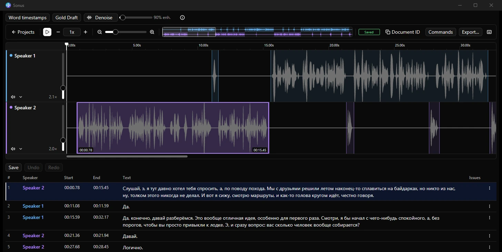

<picture>
  <source media="(prefers-color-scheme: dark)" srcset="assets/brand/header-dark.svg">
  <source media="(prefers-color-scheme: light)" srcset="assets/brand/header-light.svg">
  
</picture>

# Audio meets text.

**A segment-based transcription editor with audio.** Listen, adjust timing, assign speakers and edit the words in one native desktop workspace. Start with your own recordings, without an account.

**English** · [Русский](README.ru.md)

[Website](https://nominy.github.io/sonus/) · [Get started](docs/getting-started.md) · [Releases](https://github.com/Nominy/sonus/releases) · [Feedback](https://github.com/Nominy/sonus/issues)



## Download

| Windows x64 | Download |
| --- | --- |
| Stable installer | [Sonus-win-Setup.exe](https://github.com/Nominy/sonus/releases/latest/download/Sonus-win-Setup.exe) |
| Stable portable archive | [Sonus-win-Portable.zip](https://github.com/Nominy/sonus/releases/latest/download/Sonus-win-Portable.zip) |
| Experimental alpha installer | [Sonus-alpha-Setup.exe](https://reviewgen.ovh/sonus/alpha/win-x64/Sonus-alpha-Setup.exe) |

Stable releases use `v*` tags and GitHub Releases; alpha uses a **separate VPS feed**, not the stable release channel. Back up projects before testing alpha. macOS packages are manual alpha only; no stable macOS or Linux binary is offered here. See [distribution and updates](docs/releasing.md).

**Windows packages are unsigned.** SmartScreen may warn about an unknown publisher. Use the project's Releases for stable downloads and compare the published `SHA256SUMS`. Evaluate the source before running it; do not disable Windows protection.

### Requirements

- Windows 10/11, **x64**, an audio output, and writable space for projects and source audio.
- No Rust toolchain or service account is needed for local editing with a packaged build.
- Optional local AI on Windows uses **WebView2 and WebGPU**. Compatible GPU/drivers, RAM/VRAM and disk requirements depend on the selected models; there is no universal model-independent minimum.
- The inference runtime and **model weights download separately**, under their own licenses. Internet access is needed for downloads, updates and online services, not for manual editing of local recordings.

## A focused core, a complete toolkit

The core is the **segment editor and audio**, not a mandatory linter, AI backend or service integration.

- Edit transcript text and segment boundaries alongside audio waveforms and speaker lanes.
- Seek between segments, change playback speed, find text, undo and redo edits.
- Open local audio and native projects; save an editable project for later.
- Import/export **SRT, WebVTT and plain text** through the Formats extension. With an audio project open, use **Commands → Import transcript…** or **Export…**.
- Add basic checks, AI tools and task-service workflows through extensions.
- Customize keyboard shortcuts; Windows defaults include `Space` for play/pause outside text inputs, `←` / `→` for segment navigation, `Ctrl+Z` for undo and `Ctrl+F` for find.

The default build is **batteries included**: Local, Formats, basic checks, Gold AI tools and Babel integration are selected by Cargo features. Included code is not the same as configured service access or downloaded models. A minimal build can omit these features.

## Choose your mode

Start shows one tile per installed mode. Pick a tile; a platform mode asks you to sign in the first time you open it and remembers the account afterwards (manage accounts under **Settings › Advanced › Accounts**).

| Mode | Purpose | Access |
| --- | --- | --- |
| **Local** | Open audio and projects on this computer | No account |
| **Babel** | Optional first-party Sonus integration with Babel transcription tasks | Babel account (direct, or relay access provided by your operator) |
| **Babel error review** | Error review tasks on the same platform | Same Babel account |
| **Babel file** | Edit an exported Babel task offline | No account |

Modes are add-on contributions and declare the add-ons they require. Keep dependencies enabled while the corresponding mode is open. **Sonus is not an official Babel product and does not claim Babel endorsement.** Babel is not a prerequisite for Local.

## Extensions and privacy

Native Rust extensions supply bundled tools. Installable **WebAssembly components** use the [Rust SDK](sdk/rust/README.md) and the typed [WIT API](wit/sonus-extension.wit) to contribute commands, panels, diagnostics, formats and modes.

The [GitHub marketplace index](https://github.com/Nominy/sonus-extensions) describes extension releases; extension authors host source and versioned packages in their own GitHub repositories. The index endpoint is [`index.json`](https://raw.githubusercontent.com/Nominy/sonus-extensions/main/index.json). Inspect the author, source, compatibility and requested permissions before installing: inclusion in an index is not a security endorsement.

WASM document, audio, storage and network-host access require explicit grants. Bundled native code has the application's privileges, not an OS sandbox. Local editing does not require uploading your recording. Remote AI may send audio/text to a provider; Babel and Relay communicate with their services. Review permissions and provider terms before using sensitive material. Local processing does not make remote features offline.

## First project

1. Install Sonus, or extract the portable archive to a writable folder.
2. On Start, select **Local → Open audio…**. Each chosen audio file becomes a lane; WAV, MP3 and FLAC are good starting points. You can also open a saved project or restore unsaved work from the same screen.
3. Listen, create or adjust segments, assign speakers and edit the text. AI is optional: configure its backend and install/test local models before requesting transcription.
4. Save the native project. Export subtitles or text when needed, but keep the project and original audio as your editable source.

[Step-by-step guide / Пошаговое руководство](docs/getting-started.md)

## Build and contribute

Windows development needs Git, the Rust toolchain pinned in `rust-toolchain.toml`, MSVC C++ build tools + Windows SDK, and CMake. Package names retain `studio-*` where they identify existing model/audio crates; the product is Sonus.

```powershell
# General-purpose toolkit including AI tools, without the Babel data bundle
cargo run -p studio-app --no-default-features --features local,formats,basic-checks,gold --locked

# Local editor without the Babel/AI feature set
cargo run -p studio-app --no-default-features --features local,formats,basic-checks --locked

# Core shell without bundled modes or tools
cargo run -p studio-app --no-default-features --locked
```

The full default `cargo run -p studio-app --locked` selects all bundled features, including Babel. **It currently requires a SHA-pinned Babel data bundle available through the author's cache/private artifact store, not a public download.** Authorized maintainers prepare it with `powershell -File tools/update-babel-data.ps1 -Fetch`; the pin is `extensions/babel-lint/babel-data.json`. The general-purpose command above does not need that bundle. Helper, reviewer/drafting and Babel integration code are first-party developments by the Sonus author; bundle availability is a separate build-input concern, not a claim about ownership of that code. See [development prerequisites and checks](docs/development.md) for cache details, contributor workflow and the extension SDK.

Contributions are welcome: reproducible bug reports, code, extensions, translations and accessibility improvements. Use a synthetic recording in reports; never attach credentials, private tasks or someone else's audio. Discuss substantial changes in an [issue](https://github.com/Nominy/sonus/issues) first.

## License and acknowledgements

Sonus source is [MIT licensed](LICENSE), including its author's first-party extensions. External dependencies, model weights and independently authored extension packages retain their own licenses. Any assets copied verbatim from an upstream service require their own provenance review.

Built on Rust, GPUI / gpui-kit, Wasmtime and the wider open-source audio ecosystem. The Sonus wordmark uses outlined Outfit lettering (SIL OFL 1.1). See [acknowledgements and redistribution notes](docs/development.md#licenses-and-acknowledgements).
