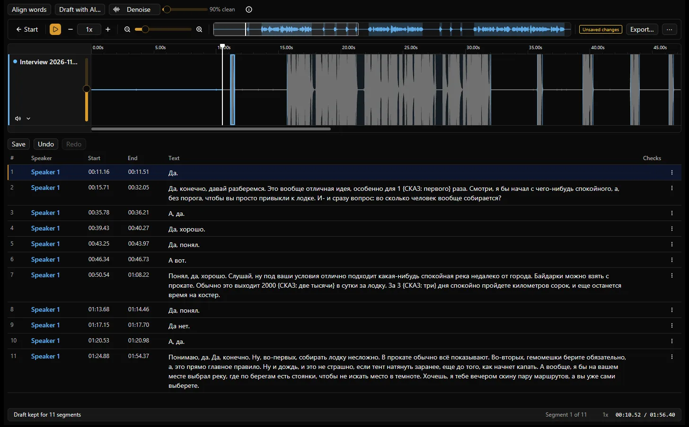

<picture>
  <source media="(prefers-color-scheme: dark)" srcset="assets/brand/header-dark.svg">
  <source media="(prefers-color-scheme: light)" srcset="assets/brand/header-light.svg">
  
</picture>

# Из звука — в слова.

Сегментный редактор транскрипций для Windows: слушайте, правьте тайминг, назначайте спикеров и редактируйте текст в одном нативном окне.
Локальные проекты не требуют аккаунта; ИИ, проверки и форматы — расширения, которые можно отключить.

[English](README.md) · **Русский** · [Сайт](https://nafty.is-a.dev/exaudio/) · [Начало работы](docs/getting-started.md#русский) · [Выпуски](https://github.com/Nominy/exaudio/releases) · [Issues](https://github.com/Nominy/exaudio/issues)



## Скачать

| Windows x64 | Ссылка |
| --- | --- |
| Установщик (стабильный) | [Exaudio-win-Setup.exe](https://github.com/Nominy/exaudio/releases/latest/download/Exaudio-win-Setup.exe) |
| Portable-архив (стабильный) | [Exaudio-win-Portable.zip](https://github.com/Nominy/exaudio/releases/latest/download/Exaudio-win-Portable.zip) |
| Установщик alpha (отдельная лента) | [Exaudio-alpha-Setup.exe](https://reviewgen.ovh/exaudio/alpha/win-x64/Exaudio-alpha-Setup.exe) |

Стабильные выпуски — теги `v*` в GitHub Releases с файлом `SHA256SUMS`. Alpha раздаётся с отдельного VPS, а не из стабильного канала обновлений; перед тестированием сделайте резервные копии проектов. Для macOS есть только ручные альфа-пакеты; стабильных сборок macOS и Linux нет. См. [распространение и обновления](docs/releasing.md).

**Windows-пакеты не подписаны.** SmartScreen может предупредить о неизвестном издателе. Скачивайте только из Releases проекта, сверяйте запись в `SHA256SUMS` и не отключайте защиту Windows.

Требования: Windows 10/11 x64, аудиовыход и место с правом записи для проектов. Локальному ИИ дополнительно нужны WebView2, видеокарта с поддержкой WebGPU и актуальными драйверами, а также отдельно скачанные модели (со своими лицензиями; размер, RAM/VRAM и диск зависят от модели). Интернет нужен для загрузок, обновлений и удалённых сервисов, но не для правки локальных записей.

## Возможности

- **Сегменты и спикеры.** У каждой реплики — спикер, начало и конец. Разделяйте по курсору, объединяйте соседние, подрезайте по звуку, переименовывайте или добавляйте спикеров из меню строки.
- **Таймлайн и волна.** По дорожке на каждый аудиофайл, масштабируемая волна, обзорная полоса, скорость воспроизведения, повтор, отмена/повтор правок. Выделите участок волны — получится сегмент.
- **Локальный ИИ.** Выравнивание слов, черновик расшифровки, заполнение пропусков и шумоподавление — на вашей видеокарте через WebView2/WebGPU или на удалённом сервере. Любой результат — черновик для проверки.
- **Проверки.** Колонка «Проверки» отмечает пустой текст, наложения на одной дорожке и лишние пробелы и предлагает безопасные быстрые исправления. Расширения добавляют свои правила.
- **Импорт и экспорт.** SRT, WebVTT и обычный текст в обе стороны через расширение Formats (**Commands → Импорт текста…** / **Export…**). Папка родного проекта хранит копию аудио и все сегменты.
- **Расширения.** Команды, панели, проверки, форматы и режимы — это расширения: встроенные написаны на Rust, устанавливаемые — WASM в песочнице.

На экране «Начало» — по плитке на каждый установленный режим. **Local** открывает аудио и проекты на этом компьютере без аккаунта. **Babel**, **Babel error review** и **Babel file** — необязательные режимы из авторской интеграции Babel; им нужен собственный доступ к сервису, для Local они не требуются. Exaudio — не официальный продукт Babel и не заявляет о его поддержке.

## Быстрый старт

1. Запустите установщик или распакуйте portable-архив в папку с правом записи и откройте `Exaudio.exe`.
2. На экране «Начало» выберите **Local → Открыть аудио…**. Каждый файл станет дорожкой; начните с WAV, MP3 или FLAC (контейнеры OGG, M4A, MP4, WebM и MKV тоже открываются — в зависимости от кодека внутри).
3. Слушайте и правьте: выделите участок волны, чтобы добавить сегмент; `S` разделяет по курсору, `D` удаляет, `Space` — воспроизведение, `←`/`→` — переход по сегментам, `Ctrl+Z`/`Ctrl+Y` — отмена/повтор, `Ctrl+F` — поиск. Полный список с переназначением — в диалоге горячих клавиш.
4. ИИ по желанию: в ИИ-расширении выберите **Этот ПК** (установите среду выполнения и модели, выполните тест устройства) или удалённый сервер, затем используйте **Align words**, **Draft with AI** или **Denoise** и проверьте результат, прежде чем оставить его.
5. **Сохраните** родной проект (папка с `project.json` и `audio/`), а при необходимости **Export…** в SRT, WebVTT или TXT. Снимки несохранённой работы, настройки и расширения хранятся в `%APPDATA%\Exaudio`.

Пошагово: [Начало работы](docs/getting-started.md#русский).

## Расширения

Устанавливаемые расширения — пакеты `.exaudio` (WebAssembly-компоненты), которые собираются с [Rust SDK](sdk/rust/README.md) по типизированному [WIT API](wit/exaudio-extension.wit). Они добавляют команды, панели, проверки, форматы и режимы, а доступ к документам, аудио, хранилищу и сетевым хостам получают только по явным разрешениям. Встроенные нативные расширения работают с правами приложения.

Открытый каталог — [`Nominy/exaudio-extensions`](https://github.com/Nominy/exaudio-extensions) ([`index.json`](https://raw.githubusercontent.com/Nominy/exaudio-extensions/main/index.json)). Авторы хранят исходники и версии пакетов в собственных репозиториях; индекс перечисляет выпуски, совместимость, хеши и запрашиваемые разрешения. Перед установкой проверяйте автора, код и разрешения — запись в каталоге не гарантирует безопасность.

## Сборка из исходников

Для Windows нужны Git, Rust из `rust-toolchain.toml`, инструменты MSVC C++ с Windows SDK и CMake. Внутренние крейты сохраняют префикс `studio-*`.

```powershell
git clone https://github.com/Nominy/exaudio.git
cd exaudio
cargo run -p studio-app
```

Стандартная сборка включает Local, Formats, базовые проверки, ИИ-инструменты Gold и интеграцию Babel и собирается из чистого клона. Подмножества features:

```powershell
# ИИ-инструменты без Babel
cargo run -p studio-app --no-default-features --features local,formats,basic-checks,gold --locked
# Только локальный редактор
cargo run -p studio-app --no-default-features --features local,formats,basic-checks --locked
```

Приватный пакет данных Babel (`tools/babel-data.json`) нужен только инструментам сверки и тестам сверки линтера; без него они пропускаются. Проверки, процесс для участников и SDK расширений — в [руководстве разработчика](docs/development.md).

## Участие

Приветствуются сообщения об ошибках, код, расширения, переводы и улучшения доступности. В отчётах и тестах используйте синтетические записи; не прикладывайте ключи, приватные задания и чужое аудио. Крупные изменения сначала обсудите в [issue](https://github.com/Nominy/exaudio/issues).

## Лицензия

[MIT](LICENSE), включая собственные расширения автора. Зависимости, веса моделей и сторонние пакеты расширений сохраняют свои лицензии. Основа — Rust, GPUI / gpui-kit и Wasmtime; надпись использует контуры букв Outfit (SIL OFL 1.1). См. [благодарности](docs/development.md#licenses-and-acknowledgements).
