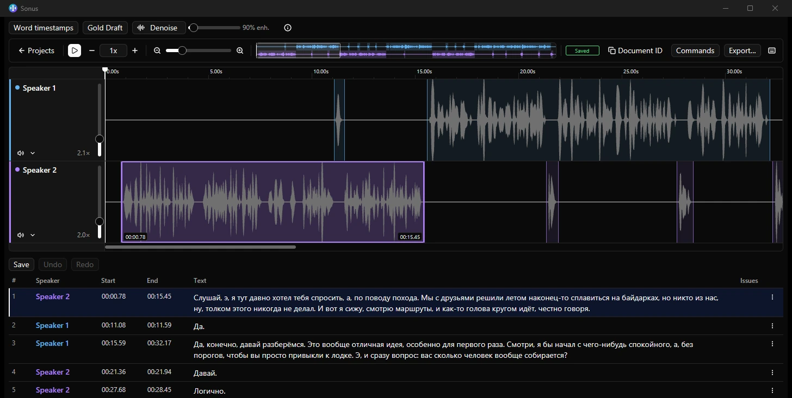

<picture>
  <source media="(prefers-color-scheme: dark)" srcset="assets/brand/header-dark.svg">
  <source media="(prefers-color-scheme: light)" srcset="assets/brand/header-light.svg">
  
</picture>

# Из звука — в слова.

**Сегментный редактор транскрипций с аудио.** Слушайте запись, уточняйте тайминг, назначайте спикеров и редактируйте текст в одном нативном приложении. Начните со своих записей — без аккаунта.

[English](README.md) · **Русский**

[Сайт](https://nominy.github.io/exaudio/) · [Начать работу](docs/getting-started.md#русский) · [Выпуски](https://github.com/Nominy/exaudio/releases) · [Обратная связь](https://github.com/Nominy/exaudio/issues)



## Скачать

| Windows x64 | Загрузка |
| --- | --- |
| Стабильный установщик | [Exaudio-win-Setup.exe](https://github.com/Nominy/exaudio/releases/latest/download/Exaudio-win-Setup.exe) |
| Стабильный portable-архив | [Exaudio-win-Portable.zip](https://github.com/Nominy/exaudio/releases/latest/download/Exaudio-win-Portable.zip) |
| Экспериментальный установщик alpha | [Exaudio-alpha-Setup.exe](https://reviewgen.ovh/exaudio/alpha/win-x64/Exaudio-alpha-Setup.exe) |

Стабильные выпуски — теги `v*` и GitHub Releases. Alpha использует **отдельную ленту на VPS**, а не стабильный канал. Перед тестированием сохраняйте резервные копии проектов. Для macOS предусмотрены только ручные альфа-пакеты; стабильных сборок macOS и Linux здесь нет. Подробнее — [распространение и обновления](docs/releasing.md).

**Windows-пакеты не подписаны сертификатом.** SmartScreen может предупредить о неизвестном издателе. Скачивайте стабильные сборки из Releases проекта и сверяйте опубликованный `SHA256SUMS`. Оцените источник перед запуском; не отключайте защиту Windows.

### Системные требования

- Windows 10/11, **x64**, аудиовыход и место с правом записи для проектов и исходного аудио.
- Для локального редактирования в готовой сборке не нужны Rust и аккаунт сервиса.
- Необязательный локальный ИИ в Windows использует **WebView2 и WebGPU**. Требования к видеокарте, драйверам, RAM/VRAM и диску зависят от моделей; общего минимума для любых моделей нет.
- Среда выполнения и **веса моделей скачиваются отдельно** и распространяются по собственным лицензиям. Интернет нужен для загрузок, обновлений и внешних сервисов, но не для ручного редактирования локальной записи.

## Компактное ядро, полный набор инструментов

Ядро — **редактор сегментов и аудио**, а не обязательный линтер, ИИ-бэкенд или интеграция с платформой заданий.

- Правьте текст и границы сегментов рядом с аудиоволнами и дорожками спикеров.
- Перемещайтесь между сегментами, меняйте скорость, ищите текст, отменяйте и повторяйте правки.
- Открывайте локальные записи и проекты; сохраняйте редактируемый проект для продолжения работы.
- Импортируйте и экспортируйте **SRT, WebVTT и обычный текст** через расширение Formats. В открытом аудиопроекте используйте **Commands → Импорт текста…** или **Export…**.
- Добавляйте базовые проверки, ИИ-инструменты и рабочие процессы сервисов через расширения.
- Настраивайте горячие клавиши. В Windows по умолчанию: `Space` — воспроизведение/пауза вне текстовых полей, `←` / `→` — переход по сегментам, `Ctrl+Z` — отмена, `Ctrl+F` — поиск.

Стандартная сборка — **batteries included**: Local, Formats, базовые проверки, ИИ-инструменты Gold и интеграция Babel выбираются Cargo features. Наличие кода не означает, что доступ к сервису настроен, а модели уже скачаны. Минимальную сборку можно собрать без этих возможностей.

## Режимы работы

На экране «Начало» — по плитке на каждый установленный режим. Выберите плитку; платформенный режим попросит войти при первом открытии и запомнит аккаунт (управление — в **Настройки › Дополнительно › Аккаунты**).

| Режим | Для чего | Доступ |
| --- | --- | --- |
| **Local** | Аудио и проекты на этом компьютере | Без аккаунта |
| **Babel** | Необязательная собственная интеграция Exaudio с заданиями на транскрипцию Babel | Аккаунт Babel (прямой или доступ через relay от вашего оператора) |
| **Babel error review** | Задания на разбор ошибок на той же платформе | Тот же аккаунт Babel |
| **Babel file** | Редактирование экспортированного задания Babel офлайн | Без аккаунта |

Режимы предоставляются дополнениями и объявляют свои зависимости. Пока режим открыт, необходимые ему дополнения должны быть включены. **Exaudio — не официальный продукт Babel; поддержка со стороны Babel не заявляется.** Babel не нужен для Local.

## Расширения и приватность

Встроенные инструменты используют нативные Rust-расширения. Устанавливаемые **WebAssembly-компоненты** создаются с [Rust SDK](sdk/rust/README.md) и типизированным [WIT API](wit/exaudio-extension.wit): команды, панели, диагностика, форматы и режимы.

[Индекс маркетплейса на GitHub](https://github.com/Nominy/exaudio-extensions) описывает выпуски расширений; исходники и версионные пакеты авторы размещают в собственных репозиториях GitHub. Адрес индекса — [`index.json`](https://raw.githubusercontent.com/Nominy/exaudio-extensions/main/index.json). Перед установкой проверяйте автора, код, совместимость и запрашиваемые разрешения: попадание в индекс не является гарантией безопасности.

WASM-доступ к документам, аудио, хранилищу и сетевым хостам выдаётся явно. Встроенный нативный код имеет права приложения, а не песочницу ОС. Для локального редактирования не нужно отправлять запись на сервер. Удалённый ИИ может передавать аудио/текст провайдеру; Babel и Relay обращаются к своим сервисам. Перед работой с чувствительными данными изучите разрешения и условия провайдера. Локальная обработка не делает удалённые функции автономными.

## Первый проект

1. Установите Exaudio или распакуйте portable-архив в папку с правом записи.
2. На экране «Начало» выберите **Local → Открыть аудио…**. Каждый выбранный файл станет дорожкой; начните с WAV, MP3 или FLAC. На том же экране можно открыть сохранённый проект или восстановить несохранённую работу.
3. Слушайте запись, создавайте и уточняйте сегменты, назначайте спикеров и правьте текст. ИИ необязателен: перед расшифровкой настройте бэкенд, а для локальной обработки установите и проверьте модели.
4. Сохраните родной проект. При необходимости экспортируйте субтитры или текст, но оставьте проект и исходное аудио как редактируемый оригинал.

[Пошаговое руководство](docs/getting-started.md#русский)

## Сборка и участие

Для разработки в Windows нужны Git, Rust из `rust-toolchain.toml`, инструменты MSVC C++ с Windows SDK и CMake. Внутренние крейты сохраняют префикс `studio-*`; название продукта и идентификаторы расширений — Exaudio.

```powershell
# Общий набор с ИИ-инструментами, без пакета данных Babel
cargo run -p studio-app --no-default-features --features local,formats,basic-checks,gold --locked

# Локальный редактор без Babel и ИИ
cargo run -p studio-app --no-default-features --features local,formats,basic-checks --locked

# Ядро без встроенных режимов и инструментов
cargo run -p studio-app --no-default-features --locked
```

Обычная команда `cargo run -p studio-app --locked` включает весь стандартный набор, в том числе Babel. **Сейчас для неё нужен пакет данных Babel с закреплённым SHA, доступный через кеш автора/приватное хранилище артефактов, а не публичную загрузку.** Разработчики с доступом подготавливают его командой `powershell -File tools/update-babel-data.ps1 -Fetch`; файл фиксации — `extensions/babel-lint/babel-data.json`. Общая сборка выше не требует этого пакета. Helper, инструменты проверки/черновиков и интеграция Babel — собственные разработки автора Exaudio; доступность пакета данных — отдельное условие сборки, а не утверждение о правах на этот код. Сведения о кеше, проверках и SDK — в [руководстве разработчика](docs/development.md).

Приветствуются воспроизводимые сообщения об ошибках, код, расширения, переводы и улучшения доступности. Для отчётов используйте синтетические записи; не прикладывайте ключи, приватные задания и чужое аудио. Крупные изменения сначала обсудите в [issue](https://github.com/Nominy/exaudio/issues).

## Лицензия и благодарности

Исходный код Exaudio, включая собственные расширения автора, — [MIT](LICENSE). Внешние зависимости, веса моделей и расширения независимых авторов сохраняют свои лицензии. Для материалов, дословно скопированных из внешнего сервиса, отдельно проверяется происхождение.

Основа приложения — Rust, GPUI / gpui-kit, Wasmtime и открытая аудиоэкосистема. Надпись Exaudio использует контуры букв Outfit (SIL OFL 1.1); её собирает `tools/brand/render.py`. См. [благодарности и условия распространения](docs/development.md#licenses-and-acknowledgements).
