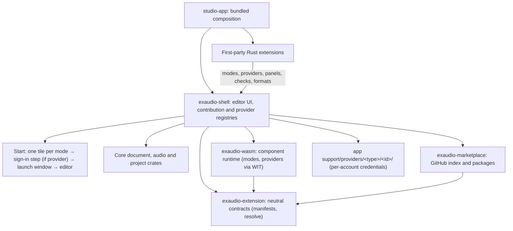

# Exaudio architecture

Implementation target for the platform cutover; this document does not claim that every
interface below is already available. Public release requires the shipped capabilities to
be implemented and exercised end to end.

Exaudio is a segment-based transcript editor with multi-lane audio playback. That is the whole
core. Everything else — AI transcription, linting, file formats, task platforms such as Babel —
is an **extension**; platforms are **modes** (Start-screen tiles) contributed by extensions,
and the accounts they sign in with are **providers**. Built-in features use exactly the same
API that third-party extensions use; there is no private side door.



## 1. Core

The core owns only what every transcript editor needs.

| Crate | Owns |
|---|---|
| `studio-core` | `Project`, speakers, audio lanes, segments, opaque extension metadata, transactions and undo history. No platform rules. |
| `studio-audio` | Common audio decoding, multi-lane playback, transport and processed-audio variants supplied by extensions. |
| `studio-waveform` | Waveform peaks and rendering. |
| `studio-project` | Versioned native project folders, copied audio, atomic save and recovery snapshots. |
| `studio-editor` | Segment editing, boundaries, cut/loop selection, find, playback-follow, caret navigation, keymaps and view state. Consumes diagnostics and presentation providers; contains no checking rules. |
| `exaudio-extension` | Versioned manifests, dependency resolution and UI-independent document/format/provider contracts. |
| `exaudio-wasm` | Sandboxed component instances and isolated compiler worker. |
| `exaudio-marketplace` | Reviewed GitHub catalog, package validation, installation, updates and rollback. |
| `exaudio-shell` | GPUI surfaces, owner-scoped contribution lifecycle, native/WASM bridges and global settings. |
| `studio-app` | Thin executable that selects and registers the bundled extensions. |

The core has **no** linter, no AI, no import/export besides its native format, no platform
logic, and no notion of "submit". "Read-only", "required checks" and "where Save goes" are
policies a mode supplies for the documents it opens.

Existing implementation crates retain their `studio-*` names. `studio-services` contains
only native HTTP/runtime/path/storage/updater services and native recovery delegated to
`studio-project` with an explicit audio source base. `studio-inference` contains provider
contracts, not an inference runtime. `extensions/gold` (`exaudio-gold`) owns the local runtime,
remote coordinator, AI preferences and provider-neutral drafting/polish algorithms;
`extensions/babel-services` (`exaudio-babel-services`) owns authentication, task/review clients,
relay hosting and Babel JSON recovery. Babel clients capture the account instance (direct or
relay-backed) per document origin; the selected account never chooses a document's save
route after the fact. Constructors do not activate modes; the host owns the selected services
and shuts down their runtime/relay resources when deactivating them. Credentials live under
the per-instance provider directory (§2.3); model-cache and draft storage paths and
serialized preference keys remain unchanged.

## 2. Extensions

An extension is a package with a manifest and code:

`manifest.json` uses the same strict schema as `exaudio_extension::ExtensionManifest`:

```json
{
  "id": "acme.filler-words",
  "name": "Filler words",
  "version": "1.0.0",
  "api": "^0.1",
  "description": "Highlights filler words and offers to remove them.",
  "license": "MIT",
  "runtime": "wasm",
  "dependencies": {},
  "permissions": [
    { "kind": "document-read" },
    { "kind": "document-edit" }
  ],
  "modes": []
}
```

WASM packages contain `module.wasm`; contributions are registered through the typed
activation API. A manifest declaration is not a permission grant. Catalog publisher and
repository identity are validated separately from the extension's own display metadata.

Built-in extensions live in `extensions/` as Rust crates and are compiled into the app.
Third-party packages run as WASM components. Installation state and versioned packages live
under the existing application-support directory's `extensions/` subtree; developer folders
are explicitly approved separately. Existing application-support paths remain unchanged.

### 2.1 Lifecycle

Native extensions register a manifest and activation factory with
`exaudio_shell::contributions::register_native_extension`. The host retains that factory for
disable/re-enable, honors persisted preferences, and removes owner-scoped contributions
and resources on deactivation. Mode dependencies prevent unsafe removal.

WASM activation and reload are acknowledged transactions. Traps, queue abuse and terminal
removal revoke that runtime generation; queued messages cannot reactivate it. Native Rust
code is trusted code with application privileges, not a sandbox: returned activation errors
are rolled back, but native panics must not be described as WASM-style containment.

### 2.2 Contribution points

Extensions extend every part of the editor — the same reach Unity editor extensions have over
the Unity editor.

**Workspace and modes**
- **Mode** — a Start-screen tile: its launch window (dashboard/browser), document sources
  (list/browse/claim/open → `Project` + origin), the save / submit pipeline for its documents,
  document policy (read-only, checks required before submit, which extensions are active in
  its documents), a settings page. `exaudio.local` is a mode like any other.
- **Provider** — an account type a mode signs in with: a setup (sign-in) view, a status
  probe and a sign-out hook. Instances are stored by the shell; credentials live in the
  instance's own directory (§2.3).
- **Document handlers** — open-file and drag-and-drop handlers by extension/MIME.
- **Importers / exporters** — bytes ⇄ `Project` (SRT, VTT, TXT, platform JSON, …).

**UI**
- **Panels** — dockable views (left/right/bottom, tabbed), optionally scoped to a mode or
  document kind. Rust: any gpui view. WASM: declarative UI tree (§3.3).
- **Windows and dialogs** — modal/non-modal, with return values.
- **Inspectors** — sections in the segment inspector for the selected segment(s).
- **Transcript extensions** — extra columns/cells per row, row badges, row context-menu items,
  text decorations (styled spans: tags, highlights), gutter markers, hover tooltips,
  inline widgets after text.
- **Timeline extensions** — overlays drawn per lane or across lanes (ranges, markers, curves,
  labels, images; Unity "gizmos"), lane-header widgets, region context-menu items, custom
  region styling, hit-testable interactive handles that emit events.
- **Toolbar, menus, status bar** — buttons, toggles, dropdowns, menu items with `when` clauses,
  status-bar items with click actions.
- **Command palette and keybindings** — commands with titles, default chords, contexts
  (`transcript`, `timeline`, `global`, mode/kind-specific) and conflict reporting in the shared
  keymap editor.
- **Notifications** — toasts, progress, confirmation prompts.
- **Settings pages** — auto-generated from a JSON Schema, or a custom view.

**Editing intelligence**
- **Diagnostics** — providers run on document snapshots (incremental: changed segments only,
  debounced by the host) or publish asynchronously into a named collection (e.g. server-side
  checks). A diagnostic has rule id, severity (error/warning/info/hint), segment, optional char
  range, message, and optional quick fixes. The core shows them (row dots, counts, navigation,
  underlines); it never decides what a rule is.
- **Quick fixes and code actions** — edits offered for a diagnostic, a selection or a segment;
  "fix all" as a command.
- **Completions** — trigger characters and contexts (e.g. tag names after `[`), with insert
  text, ranges and documentation.
- **Formatting / on-type rules** — transforms applied on commit of a segment edit.

**Audio and AI**
- **Transcription providers** — produce segments/words for lanes or ranges (streaming).
- **Alignment providers** — word timings for existing text.
- **Audio processors** — processed lane variants (denoise, enhancement) mixed by the engine.
- **Audio analysis access** — decoded samples for a lane range (permission `audio:read`).

**Hooks and events**
- Document opened/closed/saved/changed (with change sets), before-save and before-submit
  (may veto with a reason), selection/focus changed, playback started/stopped/seeked, mode
  entered/left, app quitting (may request save).

**Services available to every extension**
- Document API: read snapshot, apply a transaction of edits (undoable, labelled), per-extension
  segment/project data (`ext.<id>.*`), selection, caret, playhead, transport control.
- Tasks: background jobs with progress, cancellation and the Tasks UI.
- Storage: settings (schema-validated), key-value state, secrets (OS keyring), cache directory.
- Network: HTTP client limited to manifest-declared hosts.
- Logging into the per-extension log shown on the Extensions page.
- Inter-extension services: an extension may publish a typed service (e.g. `exaudio.babel`
  exposes its Babel client to its sibling modes); consumers declare the dependency.

### 2.3 Modes, providers and documents

A **mode** is a tile on the Start screen: a way of getting documents into the editor. The
bundled `exaudio.local` mode is a tile like any other ("open audio and projects on this
computer"); platform modes such as Babel are tiles contributed by their extensions. A
**provider** is an account type a mode signs in with (for example `exaudio.babel.account`).
Providers are invisible by default: the user sees a mode, is asked to sign in the first time
it needs an account, and otherwise never meets the provider.

**The journey**

1. **Start** lists every installed mode plus *Get more* (Extensions). No language picker here;
   it lives in Settings › General.
2. Clicking a tile calls the shell's `show_mode(id)`:
   - `enter_mode` resolves the mode's required extensions (transactional, see below).
   - If the mode manifest names a `provider`, the shell needs a configured `Ready` instance of
     that type. None configured → the provider's **setup view** is shown as a step of opening
     the mode (header "Sign in to {mode label}"); after `ProviderSetup::done` the launch
     continues. An existing instance in `NeedsSignIn` re-enters setup with that instance.
     Several instances and none selected → a small chooser, then continue.
   - The shell calls `ModeContribution.launch(shell, ModeLaunchContext { mode_id, instance })`.
     `Some(view)` is shown as the mode's **launch window** (a page under the Start / Settings /
     Extensions header). `None` means the mode opened a document itself (`launch: "direct"`) or
     declined; the shell stays where it is.
3. The editor is the base editor plus the mode's required extensions plus the user's enabled,
   compatible extensions (`active_requirements`).
4. Closing the editor returns to the mode's launch window (`launch` is invoked again) or to
   Start for `direct` modes.
5. Settings › Advanced › **Accounts** lists instances per provider type with status, *Sign out*
   and — only for `multiple: true` types — *Add another account*. A Start tile shows an account
   chip only when its provider type has more than one instance (click → switch).

**Manifest fields**

```json
{
  "providers": [{ "id": "exaudio.babel.account", "name": "Babel account", "multiple": true }],
  "modes": [{
    "id": "exaudio.babel",
    "name": "Babel",
    "provider": "exaudio.babel.account",
    "launch": "window",
    "requires": { "exaudio.babel-lint": "^0.1", "exaudio.babel-tags": "^0.1" },
    "recommends": { "exaudio.gold": "^0.1" }
  }]
}
```

- `providers[]` — `id`, `name`, `multiple` (whether several accounts may be configured).
- `modes[].provider` — optional provider id. It must be declared by the owning extension or by
  one of the mode's resolved requirements (`ResolveError::UnknownProvider` otherwise).
- `modes[].launch` — `window` (default: `launch` returns a view) or `direct` (the mode opens a
  document itself and has no launch window).
- `requires` / `recommends` — as before: hard requirements with version ranges, and optional
  recommendations that never become requirements or silently acquire permissions.

**Provider instances and storage**

A configured account is a `ProviderInstance { provider, id, label }`. `id` is stable per
account (phone-number hash, `host+user`) and path-safe (`[a-z0-9-]`). The shell's
`ProviderRegistry` persists the instance list and the selected instance per type in
`UiStorage` (`exaudio.providers.instances`, `exaudio.providers.selected`). Each provider type
contributes `ProviderContribution { id, label, multiple, setup, status, sign_out }`: a setup
view factory, a status probe (`Ready { detail } | NeedsSignIn | Error`) and a sign-out hook.

Credentials never go into the registry record. Every instance owns a directory

```
<app support>/providers/<provider type>/<instance id>/
```

(`providers::instance_dir`; the root is overridable with `STUDIO_PROVIDER_DIR`), one file per
concern; removing the instance removes the directory. There is no global "signed-in user":
a document carries its `DocumentOrigin { mode_id, instance, read_only, native_path }`, and
save, recovery, submit and the set of active document-scoped extensions are resolved from
that origin.

**WASM provider surface** (`wit/exaudio-extension.wit`)

`contribution-kind` gains `provider`. Records: `provider-instance`, `provider-setup`,
`provider-setup-result`, `provider-state`, `provider-status`; `mode-open` carries
`instance`. Events: `provider-setup`, `provider-setup-cancelled`, `provider-status`,
`provider-sign-out`. Host imports: `instance-secret-get/set`, `instance-storage-get/set`
(scoped to instances of providers the extension declares; require the `secrets` / `storage`
grants), `provider-setup-done`, `provider-setup-cancel`, `publish-provider-status`.

**Babel split**

The Babel extension declares one provider, `exaudio.babel.account` (`multiple: true`; sign-in
by phone/e-mail or by sub-account relay code — a relay-backed account is just another
instance of the same type, stored as
`providers/exaudio.babel.account/<id>/{auth.json | subaccount.json, account.json}`), and
three modes: `exaudio.babel` (Babel · transcription tasks, provider), `exaudio.babel.errors`
(Babel error review · error review tasks, provider) and `exaudio.babel-file` (Babel file · edit
an exported task offline; no provider, `launch: "direct"` — it opens the picked file
straight into the editor). The former separate "Relay" mode is gone.

**Documents**

The shell retains the active `EditorModel` independently of its rendering view.
Extension panels may query the document during rendering without reentering
`EditorScreen`'s GPUI entity borrow.
Settings and Extensions open as overlays: the active document and its mode requirements
remain intact. Disabling optional providers removes their diagnostics from the open document;
empty-text checks are not built into core draft validation.

Modes supply ordered local audio candidates through `ProviderEnvironment.audio_sources`.
Core loading never guesses platform filenames. Babel supplies its cache/export naming rules
without rewriting canonical remote source references; decoding still runs off the UI thread.

Entering a mode resolves all required extensions and version ranges before opening its
documents. Bundled packages satisfy requirements without network access. Missing packages
are offered through the marketplace; new permissions require user approval. Required
extensions activate for the mode's documents, not globally, and cannot be disabled while
those documents are open. Activation is transactional: an incompatible dependency, cycle,
denied permission or failed activation leaves the previous workspace usable. The Extensions
page shows which mode requires each extension and why.

## 3. Extension APIs

### 3.1 Rust (`exaudio-extension`)

The UI-independent contracts are in `exaudio-extension`; native UI registration is exposed by
`exaudio-shell`. For example, the bundled basic-checks extension is explicitly registered:

```rust
use gpui_kit::{App, BorrowAppContext};
use exaudio_shell::ContributionRegistry;

fn activate(cx: &mut App) -> anyhow::Result<()> {
    cx.update_global::<ContributionRegistry, _>(|registry, _| {
        registry.register_document_providers(
            exaudio_lint_basic::ID,
            "exaudio.lint-basic.checks",
            vec!["exaudio.local".into()],
            exaudio_lint_basic::providers(),
        )
    })
}

pub fn register(cx: &mut App) -> anyhow::Result<()> {
    exaudio_shell::contributions::register_native_extension(
        exaudio_lint_basic::manifest()?,
        activate,
        cx,
    )
}
```

Rust extensions may also return arbitrary gpui views for panels, windows, inspectors, mode
launch windows and provider setup views. Built-ins are Rust extensions; they never reach into
the shell or core internals.

### 3.2 WASM (`wit/exaudio-extension.wit`, world `exaudio:extension/extension@0.1.0`)

The guest exports lifecycle, command, UI-event and document-event callbacks. Providers
publish typed diagnostics, completions, decorations, UI trees and overlays through host
imports; mode, provider (setup/status/sign-out) and format requests are typed events.
`sdk/rust` wraps the generated bindings.

Host calls enforce explicit grants and document scope. Guest document IDs identify an
individual open incarnation, not a persisted project ID; stale revisions and handles from a
closed document cannot mutate its replacement. Instance calls have fuel, epoch, memory and
output limits. Untrusted component compilation runs in the separate `exaudio-wasm-worker`
process with memory and termination limits; externally supplied native/AOT artifacts are not
accepted as components.

Guest widget trees are constructed bottom-up, preserving sibling order and skipping inactive
tab branches without recursive widget construction. Docked guest panels have bounded width;
extension mode pages retain the full workspace. The Windows UI executable reserves an 8 MiB
main stack for composed GPUI views; this does not change isolated worker limits.

### 3.3 Declarative UI

WASM extensions (and Rust extensions that prefer it) describe UI as a tree the host renders
with native components: layout (`stack`, `row`, `scroll`, `split`, `tabs`), content (`text`,
`markdown`, `icon`, `image`, `waveform-snippet`), inputs (`button`, `toggle`, `text-input`,
`number`, `select`, `slider`, `list`, `table`), feedback (`progress`, `badge`, `callout`).
Events (click, change, submit, row-select) are routed back to the extension, which returns an
updated tree or a patch. Timeline overlays use a draw list (rect/range/line/curve/marker/label
in time-and-lane coordinates, with hit regions).

## 4. Built-in extensions

| Extension | Kind | Contributes |
|---|---|---|
| `exaudio.local` | mode | **Local** tile: open common audio files (one lane per file), open or restore native projects, demo. Its launch window is the local Start content. No provider; core native project save/reopen remains available without this extension. |
| `exaudio.formats` | formats | SRT, WebVTT and plain text import/export. Plain text imports explicitly have no timing. |
| `exaudio.lint-basic` | diagnostics | Optional language-neutral whitespace, empty-segment, timing and same-lane overlap checks with safe fixes. Active in Local documents by default, but not required by the mode. |
| `exaudio.gold` | AI | Local Gold runtime: transcription, word alignment, denoise; model manager and settings. |
| `exaudio.babel` | provider + modes | Provider `exaudio.babel.account` (`multiple: true`; phone/e-mail or relay sub-account sign-in, credentials per instance directory). Modes **Babel** (`exaudio.babel`, transcription tasks) and **Babel error review** (`exaudio.babel.errors`), both using that provider, plus **Babel file** (`exaudio.babel-file`, offline editing of an exported task, no provider, `launch: "direct"`). All three require `exaudio.babel-lint` and `exaudio.babel-tags`; the task modes recommend `exaudio.gold`. |
| `exaudio.babel-lint` | diagnostics | Babel's Gold (gold-non-bg) rules and the Helper rule set, with their autofixes; active in Babel documents. |
| `exaudio.babel-tags` | editing | Babel tag/curly/angle conventions: completions, decorations, tag-aware autofixes and number→СКАЗ conversion. |

`exaudio.babel-file` has a file-only save target and never selects a remote client from
whichever account happens to be selected.

## 5. Distribution

Exaudio ships **batteries included**: the release bundles the first-party extensions above.
Users can open audio, edit, check, export and open every bundled mode from Start without
separately finding extensions; platform modes ask for sign-in on first open. AI runtime/model
downloads remain explicit, with download size, licensing and
progress shown before installation; bundled extension code does not mean all model weights
are bundled. Extensions remain independently managed; required extensions activate within
their modes rather than becoming unconditional core features.

Third-party extensions are `.exaudio` files: a zip with `manifest.json`, `module.wasm`
and optional assets. Install from the Extensions page (file or URL); the page lists
extensions with version, source (bundled/installed/dev), permissions, required-by, settings,
logs and enable/disable/uninstall. Developer mode loads an unpacked folder and reloads it on
change. `extensions/examples/` holds templates.

## 6. GitHub marketplace

Each extension is a GitHub repository owned by its author. Its repository contains
`manifest.json`, source, license, documentation and versioned GitHub Releases with
`.exaudio` assets. A public index repository (`Nominy/exaudio-extensions`) is the discovery
and reviewed release catalog, not a server that executes third-party repository code.
Index contributions are pull requests.

### Catalog records

The index has a versioned schema. Each extension record identifies the stable extension ID,
GitHub owner/repository, display metadata, license, categories and released versions.
Each version records the exact manifest, Exaudio API compatibility, dependencies, declared
permissions, release tag, immutable source commit, asset name, byte size and SHA-256 digest.
Records may mark a release withdrawn with a reason. Renames or transfers cannot silently
reassign an existing extension ID.

The app caches a validated catalog and displays source repository, publisher, version,
compatibility, permissions, dependencies and bundled/installed status. Search, install,
update, disable and uninstall are available in the Extensions screen. Repository README
links provide documentation; repository Issues links provide support.

### Install and update

The host resolves compatible dependencies from the catalog, presents permission changes,
downloads the pinned release asset, verifies its size and SHA-256, and validates that its
manifest matches the catalog entry. A checksum detects substituted assets; it is not an
independent publisher signature. Catalog changes therefore remain a trust boundary reviewed
through the index repository.

Extraction rejects path traversal, absolute paths, symlinks and oversized expanded packages.
Installation is staged and switched atomically; the previous working version remains
available for rollback. A moved tag or replaced GitHub asset cannot silently change an
installed version. Updates never activate halfway through an editing transaction or remove
a dependency required by an open document.

Mode requirements use the same resolver for bundled, installed and catalog packages. When
offline, already-installed compatible dependencies continue to work; unavailable
requirements produce a precise error rather than silently disabling required behavior.

Marketplace packages run as WASM components under the host's permission and resource limits.
Native Rust extensions are trusted compiled-in components, not arbitrary downloaded DLLs.
Unpacked developer extensions are a separate, explicitly enabled development source and are
not represented as reviewed marketplace releases.

### Publishing and verification

The SDK provides a GitHub repository template and release workflow that builds a real WASM
component, validates the package, and emits the index version record. Index CI validates
schema, identity, compatibility and dependency references and verifies release-asset hashes;
it does not run contributed build scripts with repository secrets or on self-hosted runners.
A first-party example must exercise repository → release → index → in-app discovery →
installation → invocation → update/rollback before the marketplace is considered complete.

